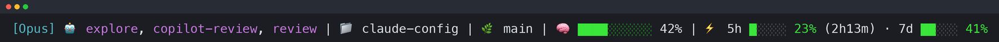

# claude-config

My personal [Claude Code](https://claude.com/claude-code) configuration — the subagents, skill, output style and statusline I currently run. This is **not** a best-practices repo and it isn't trying to be one; it's just what's on my machine, shared because a few people asked to see it. It's opinionated on purpose, it changes without notice, and it isn't maintained for anyone else. Take the bits you like and ignore the rest.

## The agents

| Agent                                            | Model  | What it does                                                                               |
| ------------------------------------------------ | ------ | ------------------------------------------------------------------------------------------ |
| [`Plan`](agents/Plan.md)                         | opus   | Read-only architect; designs the approach before any code is written                       |
| [`review`](agents/review.md)                     | opus   | Reviews changes that are already written, grounded in the repo's own skills and markdown   |
| [`build`](agents/build.md)                       | sonnet | Executes an approved plan end to end                                                       |
| [`Explore`](agents/Explore.md)                   | haiku  | Fast read-only search: where is X defined, what references Y                               |
| [`test-runner`](agents/test-runner.md)           | haiku  | Runs and writes tests; reports verbatim output and escalates judgement calls to its caller |
| [`statusline-setup`](agents/statusline-setup.md) | haiku  | Replaces the built-in of the same name; configures the statusline setting                  |
| [`appinsights`](agents/appinsights.md)           | haiku  | Runs read-only KQL against Application Insights / Log Analytics and summarises the result  |
| [`brainstorming`](agents/brainstorming.md)       | opus   | Read-only thinking partner, run as the main session; discuss and investigate, no plan      |

The split is deliberate: **opus decides, sonnet edits, haiku fetches and runs.** The expensive models do the thinking that cannot be delegated; everything mechanical — searching, running suites, relaying a script's output — goes to a cheap one that reports evidence rather than opinions.

The mixed casing is not a house style. A user-level agent replaces a built-in only if its name is the built-in's exact agent type, so `Plan`, `Explore` and `statusline-setup` are spelled the way the built-ins are. Write `plan` instead of `Plan` and it registers _alongside_ the built-in rather than replacing it — you go on quietly calling the built-in, and nothing tells you. `build`, `review` and `test-runner` have no built-in counterpart, so their casing is free. See [`CLAUDE.md`](CLAUDE.md) for the long version.

Tests are never written by default: `build` and `Plan` only grant `test-runner` the `author` mode when the user explicitly asked for tests; otherwise the plan carries a one-line **Coverage note**.

## Brainstorming

[`brainstorming`](agents/brainstorming.md) is a read-only mode for discussing, debating and investigating without the plan-file workflow. Claude Code has no custom permission modes, so it is an agent run as the main session: `claude --agent brainstorming` (I alias it to `brainstorming`). It runs on opus at max effort, has no write or web tools, and can spawn only `Explore` (code and web searches) and `appinsights` (KQL) — both read-only, so there is no transitive write path.

## Blocked commands

[`settings.json`](settings.json) hard-denies destructive Bash commands in every mode: recursive `rm`, `sudo`, `dd`, `mkfs`, `chmod -R`/`chown -R`, `git push --force`, `git reset --hard`, `git clean -f`, `git branch -D`, `terraform destroy` and `terraform apply -destroy`. They are declarative `permissions.deny` rules, so they match command text: each flag order needs its own line, and anything hidden in a script or `bash -c` is not caught.

## Code review

The [`code-review`](skills/code-review/SKILL.md) skill runs the `review` agent against an existing PR (number or branch, optional effort level and `full`). For a GitHub PR it posts the review there, with inline comments on the changed lines; those comments carry a footnote naming Claude.

## Plan files

A plan file has two readers and one section each. `## Steps` is the human's: one terse line per step, naming the file it touches. `## Build brief` is the executor's, collapsed inside a `
` so it stays out of the way — `path:line` citations, the current code and what it becomes, new signatures, call sites and the test brief. `build` and `test-runner` run on the cheaper models and follow the brief literally, so shortening it is how a decision gets guessed rather than made.

## Output style

[`output-styles/terse.md`](output-styles/terse.md) is the default (`"outputStyle": "Terse"` in [`settings.json`](settings.json)): one or two short sentences in plain words, with error messages never cut.

## Statusline

[`statusline.sh`](statusline.sh) renders one line, left to right:

- **`[Opus]`** — the active model, first word only.
- **🤖 the agents** — every subagent this session has spawned, in order of last use: `×N` for repeats, ⏳ and bold for one still in flight, `+N` when there are more than four. Inside an agent's own session it shows just that agent's name.
- **📁 directory** and **🌿 branch** — the workspace basename and the current git branch, when there is one.
- **🧠 context** — a ten-cell bar and a percentage of the context window used.
- **⚡ limits** — the 5h and 7d usage bars, green under 50%, yellow to 79%, red at 80%, with time-to-reset on the 5h window. Usage rather than price: the number that actually stops you.

The agent list comes from the `subagents/*.meta.json` sidecars written next to the transcript, which already resolve the agent type. Sessions with no sidecar directory fall back to scanning the transcript, cached by byte size — an all-or-nothing cache, because a byte offset can land mid-line and resuming there would drop the split record. `statusLine.refreshInterval` in [`settings.json`](settings.json) sets how often it re-renders.

## Requirements

`bash`, `jq` (the statusline parses JSON with it), `awk`, `git`, and `gh` for the `review` agent's PR lookups and review posting. Written and used on macOS with zsh; untested anywhere else.

## License

[The Unlicense](LICENSE) — public domain. Copy anything here without attribution.
